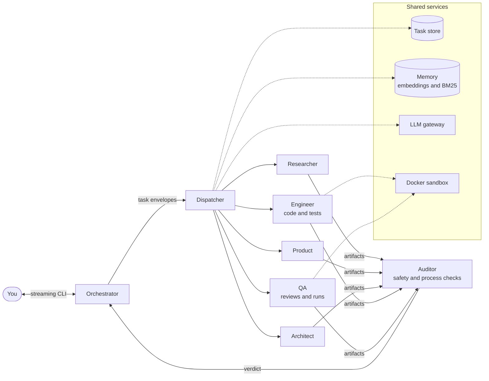
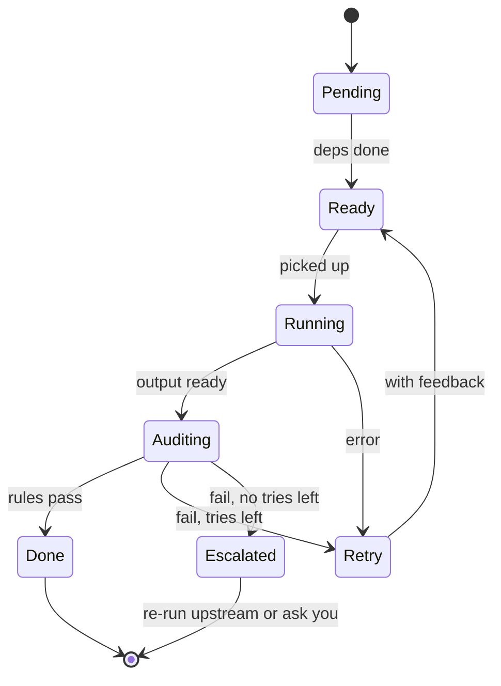

# Agent Team: Design Doc

Oct 31, 2026 · Dmitry

## Goal and scope

We're building a Python multi-agent harness for the AI Engineer Challenge. It takes a medium-size task, runs it through Planning, PRD, Spec and Implementation with expert agents, audits every step, and delivers working code you can review and change. The budget is about 20 hours over one week.

The brief grades the harness, not the model. Delegation, task tracking, auditing and re-running carry the most weight, and resilience counts more than prompt tuning. So we write the orchestration ourselves and use SDKs only to reach the models. The Tech stack section lists the tools and models.

**Bonuses in scope:** memory fetching (your pick), hooks, gateway control, a Docker sandbox and a local model. Self-improvement comes in a light form, as lessons the auditor proposes for memory. **Out of scope:** lower-level harnesses and remote access.

**Demo tasks:**

1. A REST API over a mock database, for example a small library inventory in FastAPI and SQLite.
2. An MCP server for an Obsidian-style vault that lists, reads and searches Markdown notes in a folder.

## Architecture overview

You talk only to the orchestrator, which hands every piece of work to expert agents through a dispatcher, and nothing moves on until the auditor passes it.



The auditor's verdict goes back to the orchestrator, which moves the work on, retries it or re-runs an earlier phase.

The four phases run in order, and each ends at a gate where the auditor checks that phase's rules:

1. **Planning:** the Orchestrator reads the request, decides whether it is a build or a research question, splits it into numbered asks and lists the research questions. These go into a small plan, which is audited, reviewed and versioned like any other artifact, and each research question becomes a Researcher task. The order of the phases is fixed in code, so the model never writes a task graph.
2. **PRD:** Product writes numbered requirements and acceptance criteria.
3. **Spec:** the Architect writes the design, the file plan and the test plan.
4. **Implementation:** the Engineer writes the code and its unit tests, as one task unless the Architect splits the spec into independent work packages. Then QA reviews the whole solution and runs it end to end in the sandbox.

The phase order and the gates are fixed in code. The model makes the judgment calls inside them, such as how to split the work, which phase a change request reopens, and how to answer you.

**Questions as well as builds.** The orchestrator first sorts each message: a new task to build, a change to the current run, a question about the run, or a research question. A research question runs only Planning with the Researcher and gets an answer with its sources, checked by the research rules, with no PRD or code. A question about the run, such as why the spec retried, is answered from the task store and the trace. This covers the question-answering part of the live demo.

**One chain of ids.** The plan numbers the request's asks (ASK-1), the PRD numbers requirements (REQ-1) and acceptance criteria (AC-1.1) and cites the asks they cover, the spec maps each requirement to components and files, and QA reports evidence for each criterion. Rules P1, R3, R4 and R9 check these links with code, so every ask in your request traces to a passing check, or the gate fails.

## Tech stack

There's no agent framework. The brief lets us use any harness or SDK, but it grades delegation, task tracking, auditing and re-running, and asks us to build most of the orchestration ourselves and leave only model access to tools. LangGraph, CrewAI or AutoGen would hand those exact parts to the framework, and the Claude Agent SDK or OpenAI Agents SDK would own the agent loop and tool calls. So the harness is plain Python on asyncio, and libraries only do jobs that aren't graded.

| Job | Choice | Why |
| --- | --- | --- |
| Language and packaging | Python 3.12 with uv | One lock file and fast installs; `uv run agent-team` starts it |
| Concurrency and streaming | asyncio (standard library) | Runs independent tasks in parallel and streams events to the CLI |
| Claude models | anthropic SDK, with Claude Haiku 5.5 by default and Sonnet 5.5 where an agent needs more | Official client with streaming, tool use and retries. Haiku costs $0.10 in and $0.50 out per million tokens, a few cents per run (estimate); Sonnet costs $2 and $10 |
| Local models and embeddings | openai SDK pointed at Ollama, running gpt-oss-20b or Qwen3 14B | Ollama serves an OpenAI-compatible API, so one client covers chat and embeddings. Covers the open-source and local model bonuses |
| Schemas and config | Pydantic v2 and PyYAML | Agent outputs, task envelopes and the routing file, all validated |
| Storage | sqlite3 (standard library) with WAL and FTS5 | Runs, tasks, artifacts, checkpoints, rules and memory in one file |
| Memory search | numpy | Exact cosine similarity over a few thousand vectors |
| Web research | ddgs for DuckDuckGo, httpx and trafilatura | Search, fetch, and pull readable text out of pages |
| Sandbox | Docker SDK for Python | Starts and stops the sandbox containers |
| CLI | Typer and Rich | Commands, the live streaming view and the trace tree. The brief allows a terminal, so there's no web UI |
| Tests | pytest and pytest-asyncio | Unit tests and fault-injection scenarios |
| Code quality | ruff, mypy and GitHub Actions | Lint, type checks and the fake-model test suite on every PR |

Prices are from Anthropic's model table as of 2026-10-06.

Code the Engineer writes for a task uses whatever that task needs, installed inside the sandbox. If you'd rather build on a framework, LangGraph is the one I'd pick, since it leaves the agents to us. It would take over the phase state machine and checkpoints, though, which we'd otherwise show as our own work.

## Agents and roles

The team is one orchestrator, five experts and an auditor, and every expert returns a typed artifact that code can check.

| Agent | Job | Reads | Produces | Tools |
| --- | --- | --- | --- | --- |
| Orchestrator | Talks to you, plans tasks, delegates, decides retries and re-runs | Your request, task states, audit verdicts | The plan and everything you see | Control tools only: create tasks, ask you, and read run state such as tasks, artifacts and the trace. Code validates every call |
| Researcher | Gathers facts from files and the web | A research question, plus any folders you point it at | Research brief with all the context the task needs: facts, file excerpts, constraints and open questions, each with sources | read\_file, list\_dir, grep, web\_search, web\_fetch |
| Product | Turns the request and research into a PRD | Request, research notes | PRD with numbered requirements and acceptance criteria | memory\_search |
| Architect | Turns the PRD into a technical design | PRD, research notes | Spec with components, file plan, interfaces and test plan | memory\_search |
| Engineer | Writes the code and its unit tests, file by file | Spec | Source files and unit tests in the workspace | write\_file, read\_file, run\_command |
| QA | Reviews the code and the whole solution against the PRD, and runs it end to end where possible | PRD, spec, finished code | A review report with a result and evidence for each acceptance criterion, plus issues to fix | read\_file, list\_dir, run\_command |
| Auditor | Checks each step for process errors and for anything dangerous in the code or in what agents did | Artifacts, code diffs, the tool-call log and task records | A verdict with findings | Evidence helpers and read-only access to the run; it runs no code |

- Each artifact is a Pydantic model, so code checks its shape and the auditor's evidence helpers can read exact fields such as requirement ids.
- The Engineer writes the unit tests. QA reviews the finished solution against the PRD and runs it end to end where it can, such as starting the API and calling each endpoint. That keeps an independent check on what was asked, not just what was built, and QA's blocking issues go back to the Engineer like audit findings.
- run\_command only works inside the Docker sandbox.

Context is gathered up front, but not only once. If the Architect or Engineer hits a gap, it returns a research request instead of guessing, and the orchestrator turns that into a new Researcher task.

Every expert also reads the feedback on its own work: your answers to its questions, your comments on its last version and the auditor's findings. See Questions and feedback below.

**Context compaction.** Each task starts with a fresh context built from its envelope, so agents never inherit another agent's history and most tasks stay small. Two places can still grow: a long attempt, such as the Engineer working through many files, and your conversation with the orchestrator. Each model gets a context budget in the routing file, set below its window: about 20k tokens for a 32k local model, and under 100K for Haiku, where its listed price applies. When an attempt nears its budget, these steps run in order and stop once it fits:

1. Trim large tool results. Long outputs are already saved to files, so the message keeps a short preview and the path, and the agent can read a range again if it needs to.
2. Stub old tool results. Results older than the last few steps become one-line notes, such as "read src/models.py, 120 lines", since the files are still in the workspace.
3. Summarize. One model call turns the older turns into a progress note covering what's done, the decisions made and what's left, checked against a schema.

The system prompt, the task envelope with its findings and feedback, and the latest turns are never compacted. Each compaction is a context\_compacted event with token counts before and after, and the checkpoint saves the compacted history, so a resume continues from it. The orchestrator keeps only recent turns plus a running summary of your conversation, because a run's real state lives in the task store, not the chat. Tests use the fake model with a tiny window to force each step.

## Task tracking and delegation

Every unit of work is a task row in SQLite, so any run can be inspected, resumed after a crash and partly re-run.

| Field | Meaning |
| --- | --- |
| id, run\_id, phase | Which run and phase the task belongs to |
| agent | Who does it |
| objective | One sentence on what to produce |
| inputs | Artifact versions it reads, such as prd@v2 |
| depends\_on | Tasks that must finish first |
| status | Where it is in the lifecycle below |
| attempt, max\_attempts | Retry count; the limit is 3 by default |
| output | The artifact version it produced |
| findings | Audit findings from the last attempt |
| trace\_id, span\_id | Links to its logs and trace |

Each task also records why it exists (its origin: plan, retry, revision, research request, review or change request), the task it came from, the model that ran it and its timestamps. Every state change goes through one function that checks the move is allowed and emits an event, so the tracker and the logs can't disagree.



A retry goes back to Ready with the audit findings attached, and a task with no tries left, whether it failed audit or kept erroring, is escalated to the orchestrator. Two states sit outside this loop: Waiting, while a task waits on your answer or review, and Superseded, when its inputs went stale. A run has its own status: active, waiting on you, paused, stopped or done.

**Delegation.** The orchestrator never calls an agent directly. It gives the dispatcher a task envelope with the objective, input artifacts, output schema, constraints, fetched memories and trace context. The dispatcher runs the agent with a timeout, catches errors, logs every step, and returns a result with a status, the artifact, token usage and any errors. Independent tasks run in parallel with asyncio, for example several research questions at once. Within a run, Engineer tasks run one at a time, since they share the run's workspace. Experts never call each other or create tasks: they return an artifact plus any questions or research requests, and only the orchestrator turns those into new tasks.

**Artifacts and lineage.** Artifacts are versioned files under runs/\<run\_id>/artifacts, such as plan.v1.json and prd.v2.json. Each one records the versions it was built from. When a change request produces a new PRD, everything built from the old one is marked stale and its tasks are queued again as updates, while unaffected work is kept.

**Updates, not rebuilds.** A stale task re-runs as a revision, never from scratch. The agent gets its previous output, a diff of what changed upstream and the reason, such as a change request or your comment, and is asked to change only what that diff requires.

- The Engineer edits existing files in place. The workspace keeps a git commit per version, so every revision shows as a code diff.
- The Architect's revision lists which components and files the change touches, and only those Engineer tasks re-run.
- Rule R12 is a code check that warns when a revision rewrites parts the upstream change didn't touch.
- Every attempt starts from the last audited commit. A failed attempt's edits are kept on a side branch for the trace and reset in the workspace, so a retry never builds on broken work.
- You can re-run any task yourself by asking, or with /rerun and a reason, and it runs as a revision like any other.

**Superseded tasks.** A task whose inputs went stale is marked superseded instead of deleted, so the history of every attempt stays in the trace.

**Runs and switching.** Each task you give becomes a run with its own id, title, workspace, artifacts and trace, and every run stays in the store.

- When a session starts and open runs exist, the orchestrator lists them with their status and last activity, and asks whether to continue one or start a new run.
- If a new request looks like a change to an existing run, it asks whether to apply it there or start fresh.
- You can switch mid-session by asking, or with /runs, /switch and /new. The current run pauses at the next safe point between tasks, and the other run picks up with its open questions and pending reviews.
- The active run's title shows in the prompt, so you always know where a message goes.
- One run executes at a time. The long-term store from the Memory section is shared across runs: lessons and preferences apply everywhere, while decisions and research facts are tagged with their run and fetched elsewhere only on a strong match. Workspaces, artifacts and conversations stay with their own run.
- Resuming after a crash works the same way as continuing a run.

**Checkpoints.** Each attempt saves its message history after every model or tool step, so a crash mid-attempt loses at most the step in flight.

- One row per step in a checkpoints table, keyed by attempt and step number, with the messages in a JSON column. Messages use our own provider-neutral format, so an attempt can continue on the fallback provider.
- SQLite runs with write-ahead logging, so every committed step survives a crash.
- Large tool results, such as whole file contents, are saved as files in the run folder, and the row keeps the path.
- `agent-team resume` reloads the last checkpoint and continues the attempt. Finished tool calls aren't repeated, because their results are in the checkpoint.
- A tool call that was running when the process died is retried only if the tool is marked safe to repeat, such as a file read. Otherwise the orchestrator decides, using the tool log.

This also makes a resilience demo: kill the process mid-task, resume it and watch it carry on.

## Logging, tracing and error handling

Every agent action leaves a structured log line tied to a trace, and every error is caught, classified, stored with its traceback and handled by a fixed policy.

**Log trail.** Every event goes to one JSON Lines file, runs/\<run\_id>/logs/events.jsonl. A line carries the timestamp, run, trace, span and parent span ids, agent, task, attempt, event name, level, and data such as tokens, cost, tool arguments and duration. Because each line is tagged with its agent, `agent-team logs <run_id> --agent researcher` (or a plain grep) shows one agent's own trail, and the unfiltered file keeps the whole run in time order.

**Tracing.** Spans nest in this order: run, phase, task, attempt, then each model call, tool call or audit. A span is not a separate file: opening one writes a span\_started event and closing it writes a span\_finished event with status, duration, tokens, cost and any traceback, both in the same events.jsonl and tagged like every other line. `agent-team trace <run_id>` rebuilds the tree from those events and prints it. A span that started but never finished, because the process died, shows as open. Adding `--task <id>` shows one task's whole story, including any tracebacks.

**Decision log.** Every choice the orchestrator makes is a decision event with its inputs, the option chosen and the reason: the plan, each delegation, every retry, escalation and upstream re-run, which phase a change reopens, and when to ask you. Choices made by code record the rule that applied, and choices made by the model record its stated reason. `agent-team trace --decisions` lists them, so you can see why a run went the way it did.

| Error | Example | Handling |
| --- | --- | --- |
| TransientLLMError | Rate limit, timeout, server error | Retry after 1, 2 and 4 seconds, then fall back to the next provider |
| OutputValidationError | JSON that doesn't match the schema | Send the validation errors back to the model, up to 2 times |
| ToolError | File not found, command exits non-zero | Returned to the agent as a tool result so it can adapt |
| SandboxError | Docker missing, container timeout | Task is escalated with the cause, and the orchestrator tells you |
| AuditFailure | A blocker rule fails | Retry with findings, then escalate (see the auditor section) |
| BudgetExceeded | Run passes its token, cost or time cap | Stop cleanly and save state so the run can resume |
| Any other exception | A bug in our code | Caught at the dispatcher, traceback stored, counts as a failed attempt, so it retries and then escalates |

**Tracebacks.** The dispatcher wraps every agent call. On any exception it stores the type, message and full traceback on the task record and in the log, with the trace id. One agent's error never kills the run.

**Fault injection.** The gateway can inject each of these errors on purpose, in front of real models as well as the fake one, with a `--chaos` flag. Tests and the live demo use it to show retries and recovery actually happening.

## Validation rules and the auditor

The auditor is a model agent that sweeps every step for two things: process errors, and anything dangerous in the code or in what the agents did. It never runs code, since running and testing belong to the Engineer and QA. It sweeps after every task, at every phase gate and once over the whole run, and its verdict decides whether work moves on, retries or re-runs.

Each rule has an id, a scope (task, phase or run), a severity (blocker or warning), and a plain-language statement that the auditor applies. Rules are stored in a rules table in SQLite, seeded from a catalog file in the repo so the defaults stay versioned. Each sweep loads only the rules for its scope, phase and agent, so auditing a research task brings in about six rules, not all twenty-one.

**Evidence helpers.** The model judges every rule. Where a rule has an exact answer, a few lines of Python gather the evidence first and hand it to the auditor, such as requirements with no acceptance criterion, URLs cited but never fetched, secret-like strings, or tool calls that touched paths outside the workspace. A helper hit on a blocker rule fails the step even if the model misses it, because a model can overlook one item in a long list. The verdict and its explanation always come from the model.

| Rule | Scope | Checks that | Evidence from helpers | Severity |
| --- | --- | --- | --- | --- |
| P1 Valid plan | Planning gate | The asks cover everything the request says and invent nothing, they have unique ids, the request type is right, and every research question names the ask it serves | Ask ids and research questions | Blocker |
| R1 Schema | Every task | The artifact parses into its schema | Schema validation | Blocker |
| R2 Real sources | Research tasks | Every finding cites a file or URL the Researcher actually opened | Cited sources against the tool-call log | Blocker |
| P2 Brief complete | Research tasks | The brief answers each research question it was given, or says why it couldn't | Questions without an answer | Blocker |
| R3 Testable PRD | PRD gate | Every requirement has at least one acceptance criterion | Requirements without criteria | Blocker |
| R4 Spec coverage | Spec gate | Every requirement maps to a component, and every acceptance criterion to a planned check | Unmapped ids | Blocker |
| R5 Files exist | Implementation gate | Every planned file exists, and nothing was written outside the workspace | File list | Blocker |
| R6 Tests ran | Implementation gate | The Engineer's unit tests ran and passed, according to the run log | Test result in the log | Blocker |
| R7 QA clean | Implementation gate | QA's review has no blocking issues | QA report | Blocker |
| R8 Process trail | Whole run | Every task has start and end events, a verdict and attempts within the limit, and every decision has a reason | Task store | Blocker |
| R9 Coverage and scope | PRD and Spec gates | Every ask maps to a requirement, and nothing was added that the request didn't ask for | Asks without requirements | Blocker for a missed ask, warning for additions |
| R10 Consistency | Implementation gate | The code matches the spec's interfaces | Function and route names | Warning |
| R11 Questions resolved | Every gate | Every question is answered or recorded as an assumption | Open questions | Blocker |
| R12 Minimal revision | Revisions | Only what the upstream diff requires was changed | Changed sections against the diff | Warning |
| S1 Secrets | Every task | No keys, tokens or passwords in code, logs or artifacts | Secret pattern scan | Blocker |
| S2 Dangerous code | Implementation gate | No eval or exec on input, no shell commands or SQL built from input, no unsafe deserialization, no disabled TLS checks | Pattern scan of the diff | Blocker |
| S3 Unexpected reach | Implementation gate | Code only uses the network hosts and file paths the spec allows | Hosts and paths found in the code | Blocker |
| S4 Risky dependencies | Pre-check before any install, and the implementation gate | Dependencies are known packages with pinned versions, not lookalike names | Dependency list | Warning |
| S5 Dangerous actions | Every task | No agent ran destructive commands, piped a download into a shell, or read credential files such as \~/.ssh | Tool-call log | Blocker |
| S6 Injected instructions | Every task | No agent acted on instructions found inside fetched pages or files | Fetched text next to the actions that followed | Blocker |
| S7 Data leaving | Every task | No tool call sent workspace content or secrets to an outside address | Outgoing requests in the log | Blocker |

**Keeping the judge steady.** A blocker the model raises without helper evidence gets a second, independent check before it fails a step, so one flaky judgment can't trap the run in a loop.

**The auditor itself.** Each sweep runs as an auditor task through the dispatcher, with its own log trail, timeout and retries. It fails closed: if no valid verdict comes back, the task stays unpassed and is escalated, never waved through. A verdict lists each finding with its rule id, severity, the artifact and item at fault, the evidence and a suggested fix. Warnings don't block, but they show in the phase review and the final report.

**Safety findings.** The auditor works at two points. Before each tool call, its pre-check blocks clear violations with code and asks the auditor model about unclear ones, so most tool calls add no model call. After each step, its sweep catches subtler risks. A dangerous pattern in code goes back to the Engineer like any other finding. A dangerous agent action stops the run and asks you, since it has already happened.

**What a verdict triggers:**

1. **Pass:** the task is done and the tasks that depend on it become ready.
2. **Fail with attempts left:** the task goes back to Ready as a revision of its last output, with the findings added. If a retry fails the same rules on the same items as the one before, it counts as no progress and goes straight to escalation.
3. **Fail with no attempts left:** the task is escalated. If a finding blames an upstream artifact, the orchestrator reopens the earliest one at fault, marks everything built on it stale and updates it from there; a spec gap found during implementation reopens the Spec, for example. If the fault is in the task's own output, it gets one last attempt on the stronger model before you're asked.
4. **A phase gate fails:** each finding goes to the task that produced the item at fault, which re-runs as a revision, and the tasks after it re-run too. QA's blocking issues, for example, become Engineer revisions for the files named, followed by a fresh QA review.
5. **Still failing after an upstream re-run:** the orchestrator stops and asks you, showing the findings.

Each run is capped at 3 attempts per task and 2 upstream re-runs, plus token, cost and time budgets, so it always ends.

## Questions and feedback

You can steer every phase: agents ask you questions when they need to, and you can comment on each phase's output before the next phase starts.

- **Agent questions.** Every artifact has a questions field. When an agent can't proceed safely, such as the Researcher not knowing which database you want, it returns questions instead of guessing. The orchestrator asks you, and your answers go back to that agent on its next attempt.
- **Phase reviews.** After the auditor passes a phase, the orchestrator shows you a short summary and the artifact, and you approve it or comment. A comment on the PRD goes to Product, a comment on the spec goes to the Architect, and so on.
- **What each agent reads.** On every attempt an agent receives its previous version, your answers and comments on it, and the auditor's findings. Feedback is stored per artifact version in a feedback table, so nothing is lost between attempts.
- **You are a task assignee.** A review is a task assigned to you in the tracker, with its own waiting state, logs and trace, so reviews appear in the run history like any other step.
- **Revisions flow down.** Your comment creates a new version of that artifact, and everything built from the old version is updated to match, the same as a change request.
- **Review modes.** The config sets `review` to `every_phase`, `questions_only` or `auto_assumptions`. In auto\_assumptions mode agents don't wait: they record assumptions instead of asking, and you review at the end. In `questions_only` mode agents still stop and ask you when they need to, but phases move on without your review, and you review once at the end. `every_phase` adds a review of each phase before the next one starts. The auto\_assumptions mode keeps a live demo moving, and its final review lists every assumption so you can correct any of them.
- **Rule R11, questions resolved.** A phase can't pass while any of its questions is neither answered nor recorded as an assumption.

Answers and comments that state a preference are saved to memory, so the next run doesn't ask again.

## Memory

Memory is a SQLite store with embedding and keyword search that the harness queries automatically before every task, so agents start with what earlier runs learned.

| Kind | Example | Proposed by | Saved when |
| --- | --- | --- | --- |
| Run summary | Built an inventory API; 12 tests; Spec retried twice | The memory writer, with one model call over the run's artifacts and trace | At the end of each run |
| Decision | Chose SQLite over Postgres for the mock database | The Architect, in the decisions field of its spec | When the spec passes its gate |
| Lesson | FastAPI tests need httpx installed | The auditor, from the earlier finding and the fix, when it passes a task that failed before | When that verdict is recorded |
| Preference | You want type hints and pytest | The orchestrator, when your answer or comment states a preference | When your answer or comment is recorded |
| Research fact | A fact with its source URL | The Researcher, in its brief | When the finding passes rule R2 |

**Who writes it.** No agent writes to memory directly. Each one proposes candidates in a field of its output, and a single memory writer hook saves them only after the audit passes, so unverified content never enters memory. Every memory records the run and task it came from.

**Automatic fetch.** Before dispatching a task, the harness builds a query from the task's objective, phase and agent, and ranks matches with embeddings plus SQLite's built-in BM25 search. It keeps the kinds that matter to that agent and adds them to the prompt under a cap of 10 memories and about 500 tokens. Every fetch is logged with the memory ids, so the trace shows exactly what an agent was given. Agents can also call memory\_search themselves.

In other words, it is RAG over our own memory store. It differs from typical RAG in three ways: the harness retrieves before every task instead of the agent asking, it combines meaning search with embeddings and exact-term search with BM25, and it filters by kind and run before ranking.

For each task, step by step:

1. **Build the query.** Use fixed fields only, with no model call, so the same task always builds the same query: the task's objective, agent and phase plus the titles of its input artifacts, for example "Engineer, implementation, FastAPI endpoints for books, SQLite".
2. **Filter.** Keep only the kinds that agent uses, such as lessons, decisions and preferences for the Engineer, and drop decisions and facts from other runs unless they match strongly.
3. **Search.** Embed the query with a local embedding model and compare it with each memory's stored vector, and also score exact terms with BM25 from SQLite's full-text index. Both are deterministic: the same query against the same store returns the same results.
4. **Rank.** Combine the meaning and keyword scores with recency and usefulness, and keep the best.
5. **Fit the budget.** Add memories in rank order, skipping weak matches, until 10 memories or about 500 tokens are used. Both limits are settings.
6. **Inject.** Put them in the prompt as a short Relevant memory block, one line each with its kind and source run.
7. **Log.** Record the query and memory ids in the trace, so you can see what the agent was given and credit the memories that helped.

For example, on a second API run the Engineer's prompt starts with "Lesson: FastAPI tests need httpx installed (run 3)" and "Preference: you want type hints and pytest", so it avoids the failure the first run hit.

**Ranking and upkeep.** A memory's score combines text match, recency and usefulness. Usefulness goes up each time a task that received the memory passes audit on its first try. Near-duplicates are merged when written.

**Self-improvement.** Lessons are how the system improves: a failure, the fix that worked and the rule that caught it become a lesson fetched the next time a similar task runs.

**Guardrail.** Memory is advice. The current request always wins over anything remembered.

Embedding model: nomic-embed-text runs locally through Ollama (under 300 MB), so embeddings are free and offline. Each memory is embedded once when it is saved. With a few thousand memories a plain numpy comparison takes milliseconds, so no vector database is needed. A vector database pays off at hundreds of thousands of vectors or many concurrent users; here it would add a service without better results. Retrieval sits behind one interface, so moving to sqlite-vec or a vector database later means swapping one class. If Ollama isn't running, search falls back to BM25 alone and the trace says so.

## Hooks

Logging, auditing, memory and the live terminal view are all hooks on one event bus, so new behavior never means editing the core loop.

**Events:** run\_started, phase\_started, phase\_finished, task\_started, task\_finished, llm\_call\_before, llm\_call\_after, tool\_call\_before, tool\_call\_after, audit\_verdict, decision, task\_state\_changed, task\_retried, task\_escalated, question\_asked, review\_requested, user\_message, memory\_fetched, checkpoint\_saved, context\_compacted, run\_finished.

**Two kinds of hook.** A before hook can change or block what is about to happen, such as denying a shell command or stopping a call that would pass the budget. An after hook only observes.

| Hook | Listens to | Does |
| --- | --- | --- |
| Tracer | Every event | Writes each event, spans included, to events.jsonl |
| Auditor | task\_finished, phase\_finished, run\_finished | Starts the auditor's sweep as a task |
| Memory writer | audit\_verdict, run\_finished | Saves proposed memories once their audit passes, and writes the run summary |
| Budget guard | llm\_call\_before | Blocks calls past the token or cost cap |
| Auditor pre-check | tool\_call\_before | Checks each tool call against the auditor's safety rules before it runs: blocks clear violations, asks the auditor model about unclear ones, allows the rest |
| Live view | Every event | Streams progress to your terminal |

Custom hooks load from a Python path in the config file, for example a desktop notification when a run needs you.

## LLM layer

All model calls go through one small interface with three providers, and a config file picks the provider and model for each agent.

**Interface.** `complete(messages, tools, output_schema)` and `stream(...)` return text, tool calls, token usage and cost. Our own tool-calling loop sits above it, so every tool call is logged the same way whatever the provider.

**Providers:**

- **Anthropic:** the official anthropic SDK, with claude-haiku-5-5 by default and claude-sonnet-5-5 where an agent needs more. We don't send temperature, since newer API versions reject it.
- **Ollama:** its OpenAI-compatible endpoint on localhost:11434, with the context window raised to 16k to 32k tokens.
- **Fake:** scripted responses for tests, with fault injection for bad JSON, timeouts and rate limits.

**Structured output.** Each agent declares a Pydantic output model. We validate every response ourselves, whatever the provider promises, and run the repair loop when it fails.

**Routing.** One file sets the default, per-agent overrides, the fallback order and the budget:

```yaml
defaults: {provider: anthropic, model: claude-haiku-5-5}
agents:
  engineer: {provider: anthropic, model: claude-sonnet-5-5}
  researcher: {provider: ollama, model: gpt-oss:20b}
fallbacks: [anthropic, ollama]
budget: {max_usd_per_run: 1.00, max_minutes_per_run: 30}
```

**Gateway.** Every model call and every tool call passes through one gateway, the single place to control traffic:

- **Routing and fallback:** picks the provider and model for each agent from the config, and switches to the next provider when one fails.
- **Rate limits:** caps concurrent calls and requests per minute for each provider, and queues the rest.
- **Budgets:** tracks tokens, cost and time per run and per agent, and blocks any call past a cap.
- **Tool checks:** every tool call passes the auditor's pre-check before it runs.
- **Kill switch:** `agent-team stop <run_id>` halts a run cleanly at its next call and saves its state.
- **Usage report:** `agent-team gateway status` shows calls, tokens, cost and blocked calls for a run.

The budget guard hook and the auditor's pre-check, both in the Hooks section, are how the gateway enforces these rules.

## Sandbox and user interface

Generated code runs only inside a Docker container, and you drive everything from a streaming CLI where you can inspect what was built and ask for changes.

**Sandbox:**

- Each run gets its own workspace folder, mounted into a python:3.12-slim container.
- Dependencies install in one step with the network on. The code and tests then run with the network off, CPU and memory limits, and a timeout.
- File tools reject any path outside the workspace, except folders you pass with --context, which agents can read but never write.
- Without Docker, a plain subprocess fallback runs with a timeout and a clear warning.

**Research and the network.** Research never runs in the sandbox. The Researcher's web tools run in the harness with normal network access, through the gateway. Only model-written code runs in the container, which is why its network is off. If a generated app truly needs the internet, the spec lists the hosts it needs and the sandbox allows only those through a small proxy. That is built only if a task needs it, since neither demo task does.

**CLI:**

- `agent-team run "<task>"` starts a run and streams the orchestrator's replies as they're written, with a live tree of phases and tasks. Adding --context \<folder> gives the Researcher files to work from.
- At the end you get a summary, the audit report, QA's evidence for each acceptance criterion and the test results. You accept the run or ask for changes, and the session stays open.
- You can then ask things like "show the PRD", "list the files" or "why did the spec retry?", or ask for a change in plain words.
- `agent-team trace`, `agent-team resume` and `agent-team memory search` cover inspection, crash recovery and memory.
- `agent-team stats` shows tokens, cost, time, retries and the first-pass audit rate per run and per agent, for the performance part of the demo.
- The workflow itself is driven only through the orchestrator's streaming session, as the brief requires. The other commands only read the store, apart from resume and stop, which the session also offers.

**Change requests.** The orchestrator works out which artifact the change touches first. A new endpoint changes the PRD, while a renamed function changes only the code. It creates a new version from that point, asks each later agent to update its own artifact, and shows you a diff of what changed. Before anything re-runs, it tells you which artifact it will reopen and which tasks will re-run, and waits for your go-ahead.

## Repo layout and build order

The code lives in Mr-Dm1try/agent-team and is split into small packages that mirror this doc, and the build follows the 20-hour plan with a clear check at the end of each piece.

```text
agent-team/
  pyproject.toml
  config/default.yaml
  src/agent_team/
    cli.py            streaming CLI and review session
    orchestrator/     phase state machine, planning, change requests
    agents/           base agent, researcher, product, architect, engineer, qa
    audit/            auditor, evidence helpers, rule catalog, pre-check
    core/             tasks, artifacts, events and hooks, errors, tracing, budget
    llm/              interface, gateway, anthropic, ollama, fake, structured output
    memory/           store, embeddings, retrieval, writer
    sandbox/          docker runner, subprocess fallback
    tools/            file tools, web tools
  tests/              unit tests and fault-injection scenarios
  docs/DESIGN.md      this doc, exported
  runs/               run outputs, not committed
```

| Step | Work | Hours | Done when |
| --- | --- | --- | --- |
| 1 | This design doc | 2 | You approve it |
| 2a | Task store, events and hooks, errors, tracing, LLM layer with the fake model, gateway with fault injection, decision log | 4.5 | Unit tests pass |
| 2b | Base agent, the five experts and their schemas, the dispatcher, attempt checkpoints, orchestrator control tools, question answering, context compaction | 5 | A run with the fake model completes all four phases |
| 2c | Auditor with process and safety rules, planning rules, retry, escalation, the gate fix loop and upstream re-runs | 3 | Fault-injection tests show each recovery path |
| 3a | Docker sandbox and the Engineer and QA tools | 2 | Generated code and tests run in the container |
| 3b | Streaming CLI, agent questions, phase reviews and change requests | 3.5 | A change request re-runs from the right phase |
| 3c | Memory store with embedding search, automatic fetch and lessons | 2.5 | A second run shows fetched lessons in its trace |
| 4 | Ollama provider, CI, run stats, both demo tasks end to end, slides and demo script | 4.5 | The demo is rehearsed |

The total is now 27 hours, seven over the target, after adding gateway control, phase reviews, embedding search, checkpoints, the review fixes and context compaction. Step 2 is the largest because it holds most of what gets graded.

**Trim candidates.** About 2 hours: the subprocess fallback (Docker is confirmed), switching runs mid-session beyond choosing one at the start, loading custom hooks from config, memory usefulness scoring and duplicate merging, and per-minute rate limits (a concurrency cap stays). About 1.5 hours more: build only the API demo end to end and keep the MCP server as a stretch.

## Open questions for Dmitry

- [x] Web search for the Researcher: free DuckDuckGo search (no key, sometimes flaky) or a keyed API with a free tier, such as Tavily or Brave? I'd start with DuckDuckGo. Decided: DuckDuckGo.
- [x] Is Docker Desktop, OrbStack or Colima installed on your Mac? Yes, it is.
- [x] Are the two demo tasks right, or do you have others in mind? Keeping these two for now.
- [x] Is the CLI enough for the demo, or do you want a simple web page as well? Decided: the CLI is enough.
- [ ] Create an API key in Anthropic's developer console and add $5 to $10 of credit.
- [x] Working style: I write the code in the cloud and open pull requests on agent-team. I review each PR myself and ping you only for decisions. A separate agent on your Mac, a Remote Control session, checks out each branch and runs the tests, the Docker sandbox and Ollama there, then reports back. When a PR is ready, I ping you and you merge it. Decided.
