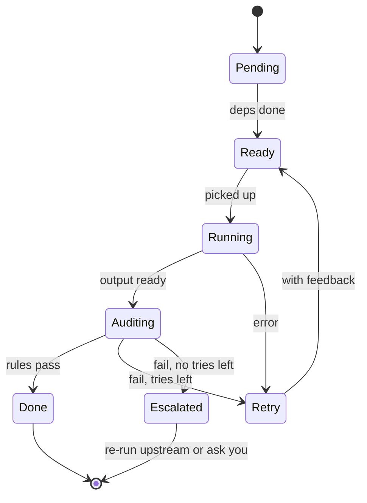

# Agent Team: Design Doc

Oct 31, 2026 · Dmitry

## Goal and scope

We're building a Python multi-agent harness for the AI Engineer Challenge. It takes a medium-size task, runs it through Planning, PRD, Spec and Implementation with expert agents, audits every step, and delivers working code you can review and change. The budget is about 20 hours over one week.

The brief grades the harness, not the model. Delegation, task tracking, auditing and re-running carry the most weight, and resilience counts more than prompt tuning. So we write the orchestration ourselves and use SDKs only to reach the models. The Tech stack section lists the tools and models.

**Bonuses in scope:** memory fetching (your pick), hooks, gateway control, a Docker sandbox and a local model. Self-improvement comes in a light form, as lessons the auditor proposes for memory. **Out of scope:** lower-level harnesses and remote access.

**Demo tasks:**

1. A REST API over a mock database, for example a small library inventory in FastAPI and SQLite.
2. An MCP server for an Obsidian-style vault that lists, reads and searches Markdown notes in a folder.

## Architecture overview

You talk only to the orchestrator, which hands every piece of work to expert agents through a dispatcher, and nothing moves on until the auditor passes it.


The auditor's verdict goes back to the orchestrator, which moves the work on, retries it or re-runs an earlier phase.

The four phases run in order. There are no phase gates: every rule runs in the check at the end of the task that already sees what the rule is about, and a phase is finished once all of its tasks have passed their checks:

1. **Planning:** the Orchestrator reads the request, decides whether it is a build or a research question, splits it into numbered asks and lists the research questions. These go into a small plan, which is audited, reviewed and versioned like any other artifact, and each research question becomes a Researcher task. The order of the phases is fixed in code, so the model never writes a task graph.
2. **PRD:** Product writes numbered requirements and acceptance criteria.
3. **Spec:** the Architect writes the design, the file plan and the test plan.
4. **Implementation:** the Engineer writes the code and its unit tests, as one task unless the Architect splits the spec into independent work packages. Then QA reviews the whole solution and runs it end to end in the sandbox.

The phase order and which rules each task's check runs are fixed in code. The model makes the judgment calls inside them, such as how to split the work, which phase a change request reopens, and how to answer you.

**Questions as well as builds.** The orchestrator first sorts each message: a new task to build, a change to the current run, a question about the run, or a research question. A research question runs only Planning with the Researcher and gets an answer with its sources, checked by the research rules, with no PRD or code. The answer is written for you: notes on how it was researched, such as which part of a page was read, go in the answer's `gaps` and each source's `read` field, which the review doesn't print, and a note left in a source's title is moved to `read` in code. A question about the run, such as why the spec retried, is answered from the task store and the trace. This covers the question-answering part of the live demo.

The message loop's reply names the sort, and code holds the actions to it, so no question is answered from the model's memory. With no run open, a message sorted as a research question or a build starts that run even when the model wrote an answer instead, and a message about a run (a question, a change, an approval such as "accept") gets a short reply that no run is open. With a run open, new work must come with `start_run`, an answer to something waiting must come with `answer_pending`, and an unclear message gets one clarifying question; otherwise the reply goes back to the model to fix.

The loop has five tool turns. After them its model call may only reply (tool choice "none"; Ollama, which has no tool choice, gets no tools), so a model that keeps reading answers from what it read instead of running out of steps. `answer_pending` is offered only while something waits on you, so an old escalation in a finished run's history can't be answered again. `read_trace` gives one short line per event and leaves out checkpoint and span bookkeeping; it filters by task, agent, event name or warnings and errors, and gives an event's JSON only when asked.

**One chain of ids.** The plan numbers the request's asks (ASK-1), the PRD numbers requirements (REQ-1) and acceptance criteria (AC-1.1) and cites the asks they cover, the spec maps each requirement to components and files, and QA reports evidence for each criterion. Rules P1, R3, R4 and R9 check these links with code, so every ask in your request traces to a passing check, or the task that broke the chain fails its check.

## Tech stack

There's no agent framework. The brief lets us use any harness or SDK, but it grades delegation, task tracking, auditing and re-running, and asks us to build most of the orchestration ourselves and leave only model access to tools. LangGraph, CrewAI or AutoGen would hand those exact parts to the framework, and the Claude Agent SDK or OpenAI Agents SDK would own the agent loop and tool calls. So the harness is plain Python on asyncio, and libraries only do jobs that aren't graded.

| Job | Choice | Why |
| --- | --- | --- |
| Language and packaging | Python 3.12 with uv | One lock file and fast installs; `uv run agent-team` starts it |
| Concurrency and streaming | asyncio (standard library) | Runs independent tasks in parallel and streams events to the CLI |
| Claude models | anthropic SDK, with Claude Haiku 5.5 by default and Sonnet 5.5 where an agent needs more | Official client with streaming, tool use and retries. Haiku costs $0.10 in and $0.50 out per million tokens, a few cents per run (estimate); Sonnet costs $2 and $10 |
| Local models and embeddings | httpx against Ollama's native API, running gpt-oss-20b or Qwen3 14B | The native /api/chat honours the context window we ask for, which the OpenAI-compatible endpoint ignores; /api/embed covers embeddings. Covers the open-source and local model bonuses |
| Schemas and config | Pydantic v2 and PyYAML | Agent outputs, task envelopes and the routing file, all validated |
| Storage | sqlite3 (standard library) with WAL and FTS5 | Runs, tasks, artifacts, checkpoints, rules and memory in one file |
| Memory search | numpy | Exact cosine similarity over a few thousand vectors |
| Web research | ddgs for DuckDuckGo, httpx and trafilatura | Search, fetch, and pull readable text out of pages |
| Sandbox | Docker SDK for Python | Starts and stops the sandbox containers |
| CLI | Typer and Rich | Commands, the live streaming view and the trace tree. The brief allows a terminal, so there's no web UI |
| Tests | pytest and pytest-asyncio | Unit tests and fault-injection scenarios |
| Code quality | ruff, mypy and GitHub Actions | Lint, type checks and the fake-model test suite on every PR |

Prices are from Anthropic's model table as of 2026-10-06.

Code the Engineer writes for a task uses whatever that task needs, installed inside the sandbox. If you'd rather build on a framework, LangGraph is the one I'd pick, since it leaves the agents to us. It would take over the phase state machine and checkpoints, though, which we'd otherwise show as our own work.

## Agents and roles

The team is one orchestrator, five experts and an auditor, and every expert returns a typed artifact that code can check.

| Agent | Job | Reads | Produces | Tools |
| --- | --- | --- | --- | --- |
| Orchestrator | Talks to you, plans tasks, delegates, decides retries and re-runs | Your request, task states, audit verdicts | The plan and everything you see | Control tools only: create tasks, ask you, and read run state such as tasks, artifacts and the trace. Code validates every call |
| Researcher | Gathers facts from files and the web | A research question, plus any folders you point it at | Research brief with all the context the task needs: facts, file excerpts, constraints and open questions, each with sources | read\_file, list\_dir, grep, web\_search, web\_fetch |
| Product | Turns the request and research into a PRD | Request, research notes | PRD with numbered requirements and acceptance criteria | memory\_search |
| Architect | Turns the PRD into a technical design | PRD, research notes | Spec with components, file plan, interfaces and test plan | memory\_search |
| Engineer | Writes the code and its unit tests, file by file | Spec | Source files and unit tests in the workspace | write\_file, read\_file, run\_command, install\_deps |
| QA | Reviews the code and the whole solution against the PRD, and runs it end to end where possible | PRD, spec, finished code | A review report with a result and evidence for each acceptance criterion, plus issues to fix | read\_file, list\_dir, run\_command, install\_deps |
| Auditor | Checks each step for process errors and for anything dangerous in the code or in what agents did | Artifacts, code diffs, the tool-call log and task records | A verdict with findings | Evidence helpers and read-only access to the run; it runs no code |

- Each artifact is a Pydantic model, so code checks its shape and the auditor's evidence helpers can read exact fields such as requirement ids.
- The Engineer writes the unit tests. QA reviews the finished solution against the PRD and runs it end to end where it can, such as starting the API and calling each endpoint. That keeps an independent check on what was asked, not just what was built, and QA's blocking issues go back to the Engineer like audit findings.
- run\_command and install\_deps only work inside the Docker sandbox. install\_deps is the one step with the network on, and it takes only plain package specifiers, so the pre-check sees every package it installs.

Context is gathered up front, but not only once. If the Architect or Engineer hits a gap, it returns a research request instead of guessing, and the orchestrator turns that into a new Researcher task.

**Research requests are bounded.** Without limits, research fans out: in one demo run four planned questions became 22 requested tasks, many of them the same question, and planning never ended. So:

- A request that repeats a question the run already asked is answered by that task. Questions match on their content words (with filler such as "the official docs" dropped), at 85% overlap, so a question about GitLab doesn't take GitHub's answer; a question with no content words left matches nothing. A finished brief joins the asker's inputs, and open requested research (or a revision of it) is waited for, unless it already waits on the asker. A question a planned task is still researching, or one whose answer is already in the asker's inputs, is refused.
- A task made from a request can't ask for more (`limits.max_research_depth`, 1), and a run makes at most `limits.max_research_tasks` (6) requested tasks.
- Past a limit, the request is refused, the decision log says why, and the task is told to answer with what it has. A refused task may not ask again. A task that may not ask is told so in its envelope, and any request it still files is turned into what is still open: an unanswered question with its gap in a brief, or a question with an assumption elsewhere.

Every expert also reads the feedback on its own work: your answers to its questions, your comments on its last version and the auditor's findings. See Questions and feedback below.

**Steps and web calls.** An attempt has a step limit (80 by default), and a local model can spend it all fetching. When 15% of the steps are left, the model's next turn says how many it has and that it must write its output now, with what it doesn't know as gaps. The web tools also share a budget per attempt (`web.max_calls_per_attempt`, 30): past it, web\_search and web\_fetch refuse with the same advice. A garbled tool call from Ollama is retried inside the one model call, so it takes no step.

**Context compaction.** Each task starts with a fresh context built from its envelope, so agents never inherit another agent's history and most tasks stay small. Two places can still grow: a long attempt, such as the Engineer working through many files, and your conversation with the orchestrator. Each model gets a context budget in the routing file, set below its window: about 20k tokens for a 32k local model, and under 100K for Haiku, where its listed price applies. While an agent's own provider is down and a fallback stands in, the fallback's budget applies: the defaults' budget, cut for Ollama to what its window holds. When an attempt nears its budget, these steps run in order and stop once it fits:

1. Trim large tool results. Long outputs are already saved to files, so the message keeps a short preview and the path, and the agent can read a range again if it needs to.
2. Stub old tool results. Results older than the last few steps become one-line notes, such as "read src/models.py, 120 lines", since the files are still in the workspace.
3. Summarize. One model call turns the older turns into a progress note covering what's done, the decisions made and what's left, checked against a schema.

Every step here rewrites history the model has already seen, so Claude's thinking blocks from after the rewritten point no longer match. The provider asks the API to drop such blocks rather than fail the call, so the next turn runs without that reasoning. The summary in step 3 should therefore carry what the model needs to keep going. The system prompt, the task envelope with its findings and feedback, and the latest turns are never compacted. Each compaction is a context\_compacted event with token counts before and after, and the checkpoint saves the compacted history, so a resume continues from it. The orchestrator keeps only recent turns plus a running summary of your conversation, because a run's real state lives in the task store, not the chat. Tests use the fake model with a tiny window to force each step.

## Task tracking and delegation

Every unit of work is a task row in SQLite, so any run can be inspected, resumed after a crash and partly re-run.

| Field | Meaning |
| --- | --- |
| id, run\_id, phase | Which run and phase the task belongs to |
| agent | Who does it |
| objective | One sentence on what to produce |
| inputs | Artifact versions it reads, such as prd@v2 |
| depends\_on | Tasks that must finish first |
| status | Where it is in the lifecycle below |
| attempt, max\_attempts | Retry count; the limit is 3 by default |
| output | The artifact version it produced |
| findings | Audit findings from the last attempt |
| trace\_id, span\_id | Links to its logs and trace |

Each task also records why it exists (its origin: plan, retry, revision, research request, review or change request), the task it came from, the model that ran it and its timestamps. Every state change goes through one function that checks the move is allowed and emits an event, so the tracker and the logs can't disagree.



A retry goes back to Ready with the audit findings attached, and a task with no tries left, whether it failed audit or kept erroring, is escalated to the orchestrator. Two states sit outside this loop: Waiting, while a task waits on your answer or review, and Superseded, when its inputs went stale. A run has its own status: active, waiting on you, paused, stopped or done.

**Delegation.** The orchestrator never calls an agent directly. It gives the dispatcher a task envelope with the objective, input artifacts, output schema, constraints, fetched memories and trace context. The dispatcher runs the agent with a timeout, catches errors, logs every step, and returns a result with a status, the artifact, token usage and any errors. Independent tasks run in parallel with asyncio, for example several research questions at once. Within a run, Engineer tasks run one at a time, since they share the run's workspace. Experts never call each other or create tasks: they return an artifact plus any questions or research requests, and only the orchestrator turns those into new tasks.

**Artifacts and lineage.** Artifacts are versioned files under runs/\<run\_id>/artifacts, such as plan.v1.json and prd.v2.json. Each one records the versions it was built from and the task that wrote it. Versions are numbered per kind across the run, so two research questions share one counter; a revision's previous version is the latest one its own line of work wrote (the task and the tasks it was reopened from), never a sibling's. A line of work starts at a task that is new work: a planned task, or one made from a research request, a question or a check. Such a task has a parent but doesn't redo it, so its first output has no previous version, and it gets neither the parent's output nor its findings. When a change request produces a new PRD, everything built from the old one is marked stale and its tasks are queued again as updates, while unaffected work is kept.

**Updates, not rebuilds.** A stale task re-runs as a revision, never from scratch. The agent gets its previous output, a diff of what changed upstream and the reason, such as a change request or your comment, and is asked to change only what that diff requires.

- The Engineer edits existing files in place. The workspace keeps a git commit per version, so every revision shows as a code diff.
- The Architect's revision lists which components and files the change touches, and only those Engineer tasks re-run.
- Rule R12 is a code check that warns when a revision rewrites parts the upstream change didn't touch.
- Every attempt starts from the last audited commit. A failed attempt's edits are kept on a side branch for the trace and reset in the workspace, so a retry never builds on broken work.
- You can re-run any task yourself by asking, or with /rerun and a reason, and it runs as a revision like any other.

**Superseded tasks.** A task whose inputs went stale is marked superseded instead of deleted, so the history of every attempt stays in the trace.

**Runs and switching.** Each task you give becomes a run with its own id, title, workspace, artifacts and trace, and every run stays in the store.

- When a session starts and open runs exist, the orchestrator lists them with their status and last activity, and asks whether to continue one or start a new run.
- If a new request looks like a change to an existing run, it asks whether to apply it there or start fresh.
- You can switch mid-session by asking, or with /runs, /switch and /new. The current run pauses at the next safe point between tasks, and the other run picks up with its open questions and pending reviews.
- The active run's title shows in the prompt, so you always know where a message goes.
- One run executes at a time. The long-term store from the Memory section is shared across runs: lessons and preferences apply everywhere (a lesson only to the agent that learned it), while decisions and research facts are tagged with their run and fetched elsewhere only on a strong match. Workspaces, artifacts and conversations stay with their own run.
- Resuming after a crash works the same way as continuing a run.

**Checkpoints.** Each attempt saves its message history after every model or tool step, so a crash mid-attempt loses at most the step in flight.

- One row per step in a checkpoints table, keyed by attempt and step number, with the messages in a JSON column. Messages use our own provider-neutral format, so an attempt can continue on the fallback provider.
- SQLite runs with write-ahead logging, so every committed step survives a crash.
- Large tool results, such as whole file contents, are saved as files in the run folder, and the row keeps the path.
- `agent-team resume` reloads the last checkpoint and continues the attempt. Finished tool calls aren't repeated, because their results are in the checkpoint.
- Resuming a finished run only shows it: the tree, the summary and the review prompt. Nothing re-runs, not even the run's final check, and no lifecycle event (phase\_finished, run\_finished) is written again. You can still ask about it or request a change.
- A tool call that was running when the process died is retried only if the tool is marked safe to repeat, such as a file read. Otherwise the orchestrator decides, using the tool log.

This also makes a resilience demo: kill the process mid-task, resume it and watch it carry on.

## Logging, tracing and error handling

Every agent action leaves a structured log line tied to a trace, and every error is caught, classified, stored with its traceback and handled by a fixed policy.

**Log trail.** Every event goes to one JSON Lines file, runs/\<run\_id>/logs/events.jsonl. A line carries the timestamp, run, trace, span and parent span ids, agent, task, attempt, event name, level, and data such as tokens, cost, tool arguments and duration. Because each line is tagged with its agent, `agent-team logs <run_id> --agent researcher` (or a plain grep) shows one agent's own trail, and the unfiltered file keeps the whole run in time order.

**Tracing.** Each run is one trace. Spans nest in this order: the run, each pass through a phase, task, attempt, then each model call, tool call or check. A task's check is an auditor task, so its attempts sit under the task next to the producer's, and each holds the auditor's model calls. A message you send about a run is a span in that run too. The run keeps its trace id and root span id, so a run resumed in a new process adds to the same tree. A span is not a separate file: opening one writes a span\_started event and closing it writes a span\_finished event with status, duration, tokens, cost and any traceback, both in the same events.jsonl and tagged like every other line. `agent-team logs <run_id> --spans` rebuilds the tree from those events and prints it. A span that started but never finished, because the process died, shows as open; the run's own span stays open until the run is done. `agent-team logs <run_id> --task <id>` shows one task's whole story, including any tracebacks.

**Decision log.** Every choice the orchestrator makes is a decision event with its inputs, the option chosen and the reason: the plan, each delegation, every retry, escalation and upstream re-run, which phase a change reopens, and when to ask you. Choices made by code record the rule that applied, and choices made by the model record its stated reason. They are decision lines in the run's log, so `agent-team logs <run_id>` shows why a run went the way it did.

| Error | Example | Handling |
| --- | --- | --- |
| TransientLLMError | Rate limit, timeout, server error, refused connection | Retry after 1, 2 and 4 seconds, then fall back to the next provider. A refused connection isn't retried: the provider is marked down for a minute and calls go straight to the fallback |
| ContextTooLong | A prompt too big for a local model's window, found before sending | Fall back to the next provider at once; if none is left, compact and retry the attempt |
| OutputValidationError | JSON that doesn't match the schema | Send the validation errors back to the model, up to 2 times; the model may make a tool call first, such as writing the file a check says is missing. An attempt that still fails counts like a failed check: the same failure on two attempts in a row is no progress and escalates at once, and an escalated attempt gets one last try on the stronger model before you're asked. It counts against the first-pass rate too |
| ToolError | File not found, command exits non-zero | Returned to the agent as a tool result so it can adapt |
| SandboxError | Docker missing, a container that can't be created or is lost | Missing Docker stops the run at start with how to fix it. A container failure during a command comes back to the model as a tool error it can retry; a command that runs past its timeout is killed and reports exit 124 |
| AuditFailure | A blocker rule fails | Retry with findings, then escalate (see the auditor section) |
| BudgetExceeded | Run passes its token, cost or time cap | Stop cleanly and save state so the run can resume |
| Any other exception | A bug in our code | Caught at the dispatcher, traceback stored, counts as a failed attempt, so it retries and then escalates |

**After a failed attempt.** The next attempt's envelope says how the attempt before it failed, the commands it ran with their exit codes and the files it wrote, read from the tool log, so a retry builds on what it learned instead of reinstalling and re-reading from scratch. A reply cut off at the output token limit doesn't run its last tool call, whose arguments may be cut too; the model is told to send less per call. The Engineer reports file paths, not file contents, in its final JSON.

**Tracebacks.** The dispatcher wraps every agent call. On any exception it stores the type, message and full traceback on the task record and in the log, with the trace id. One agent's error never kills the run.

**Fault injection.** The gateway can inject each of these errors on purpose, in front of real models as well as the fake one, with a `--chaos` flag. Tests and the live demo use it to show retries and recovery actually happening.

## Validation rules and the auditor

The auditor is a model agent that sweeps every step for two things: process errors, and anything dangerous in the code or in what the agents did. It never runs code, since running and testing belong to the Engineer and QA. It sweeps at the end of every task and once over the whole run, and its verdict decides whether work moves on, retries or re-runs. QA's check covers every live output of the Implementation phase, so the rules about code see every code change.

Each rule has an id, a scope (task or run), the agents whose tasks it applies to, a severity (blocker or warning), and a plain-language statement that the auditor applies. Rules are stored in a rules table in SQLite, seeded from a catalog file in the repo so the defaults stay versioned. Each sweep loads only the rules for its scope, phase and agent, so auditing a research task brings in about six rules, not all twenty-one.

**Evidence helpers.** The model judges every rule. Where a rule has an exact answer, a few lines of Python gather the evidence first and hand it to the auditor, such as requirements with no acceptance criterion, URLs cited but never fetched, secret-like strings, or tool calls that touched paths outside the workspace. A helper hit on a blocker rule fails the step even if the model misses it, because a model can overlook one item in a long list. The verdict and its explanation always come from the model.

| Rule | Scope | Checks that | Evidence from helpers | Severity |
| --- | --- | --- | --- | --- |
| P1 Valid plan | The plan task | The asks cover everything the request says and invent nothing, they have unique ids, the request type is right, and every research question names the ask it serves | Ask ids and research questions | Blocker |
| R1 Schema | Every task | The artifact parses into its schema | Schema validation | Blocker |
| R2 Real sources | Research tasks | Every finding cites a file or URL the Researcher actually opened, and every version it pins shows up in a source it opened. The prompt adds that a source is cited only if the part backing the claim was read | Cited sources and pinned versions against the tool-call log; a pin from your request needs no source. URLs match exactly, except that a trailing slash, a #fragment and utm\_\* parameters are dropped, and GitHub's blob and raw views of one file are the same source | Blocker |
| P2 Brief complete | Research tasks | The brief answers each research question it was given, or says why it couldn't; a final answer is written from its briefs and doesn't contradict them | Questions without an answer; the briefs' answers, and versions the final answer pins that its briefs don't | Blocker |
| R3 Testable PRD | Product's task | Every requirement has at least one acceptance criterion | Requirements without criteria | Blocker |
| R4 Spec coverage | The Architect's task | Every requirement maps to a component, and every acceptance criterion to a planned check | Unmapped ids | Blocker |
| R5 Files exist | QA's task, over every code change | Every planned file exists, and nothing was written outside the workspace | File list | Blocker |
| R6 Tests ran | Each Engineer task | The Engineer's unit tests ran and passed, according to the run log | The logged run of the reported command, matched after unwrapping `sh -c` and dropping `VAR=` prefixes; its exit code, or its pytest summary when a `;`, `\|\|` or pipe after the tests can mask the exit code | Blocker |
| R7 QA clean | QA's task | QA's review has no blocking issues | QA report | Blocker |
| R8 Process trail | Whole run | Every task has start and end events, a verdict and attempts within the limit, and every decision has a reason. The attempt on the stronger model is granted past the limit by design, so it shows as "attempt 4 (stronger model)", not 4/4 | Task store and decision log | Blocker |
| R9 Coverage and scope | Product's and the Architect's tasks | Every ask maps to a requirement, and nothing was added that the request didn't ask for | Asks without requirements | Blocker for a missed ask, warning for additions |
| R10 Consistency | QA's task, over every code change | The code matches the spec's interfaces | Function and route names | Warning |
| R11 Questions resolved | Every task, on its final output | Every question the task's output raises is answered or recorded as an assumption | Open questions | Blocker |
| R12 Minimal revision | Revisions | Only what the upstream diff requires was changed | Changed sections against the diff | Warning |
| S1 Secrets | Every task | No keys, tokens or passwords in code, logs or artifacts | Secret pattern scan of outputs, code and tool calls; web results are left out, since a tutorial's sample token is outside text that S6 already checks | Blocker |
| S2 Dangerous code | QA's task, over every code change | No eval or exec on input, no shell commands or SQL built from input, no unsafe deserialization, no disabled TLS checks | Pattern scan of the diff | Blocker |
| S3 Unexpected reach | QA's task, over every code change | Code only uses the network hosts and file paths the spec allows | Hosts and paths found in the code | Blocker |
| S4 Risky dependencies | Pre-check before any install, and QA's task | Dependencies are known packages with pinned versions, not lookalike names | Dependency list | Warning |
| S5 Dangerous actions | Every task | No agent ran destructive commands, piped a download into a shell, or read credential files such as \~/.ssh | Tool-call log | Blocker |
| S6 Injected instructions | Every task | No agent acted on instructions found inside fetched pages or files | Fetched text next to the actions that followed | Blocker |
| S7 Data leaving | Every task | No tool call sent workspace content or secrets to an outside address | Outgoing requests in the log | Blocker |

**Keeping the judge steady.** A blocker the model raises without helper evidence gets a second, independent check before it fails a step, so one flaky judgment can't trap the run in a loop. A helper finding about a tool call that already ran, such as a secret in a file an agent read, can't be cleared by a retry either, so it is marked as such and goes to you at once (see below). The other helpers that read the tool log are S5, S6 and S7, which already stop the run and ask you, and R2 and R6, which a retry can satisfy by opening the source or running the tests.

**The auditor itself.** Each sweep runs as an auditor task through the dispatcher, with its own log trail, timeout and retries. An auditor that crashes, times out or returns no valid verdict uses the check's attempts (3 by default), never the attempts of the work it checks. It fails closed: once the check's attempts run out, the work stays unpassed and you are asked, and work that was never checked can't be kept as it is. A verdict lists each finding with its rule id, severity, the artifact and item at fault, the evidence and a suggested fix. It also keeps the helpers' notes by rule, such as the logged test run R6 matched, so a pass can be checked later. Warnings don't block, but they show in the phase review and the final report.

**Safety findings.** The auditor works at two points. Before each tool call, its pre-check blocks clear violations with code and asks the auditor model about unclear ones, so most tool calls add no model call. After each step, its sweep catches subtler risks. A dangerous pattern in code goes back to the Engineer like any other finding. A dangerous agent action stops the run and asks you, since it has already happened.

**What a verdict triggers:**

1. **Pass:** the task is done and the tasks that depend on it become ready.
2. **Fail with attempts left:** the task goes back to Ready as a revision of its last output, with the findings added. If a retry or fix fails the same rules on the same items as the one before, counting the tasks it was reopened from, it counts as no progress and goes straight to escalation.
3. **Fail with no attempts left:** the task is escalated. If a finding blames an upstream artifact, the orchestrator reopens the earliest one at fault as a fix, marks everything built on it stale and updates it from there; a spec gap found during implementation reopens the Spec, for example. If the fault is in the task's own output, it gets one last attempt on the stronger model before you're asked.
4. **A check finds a fault in other work of the same phase:** the finding goes to the task that produced the item at fault, which re-runs as a fix, and the tasks after it re-run too. QA's blocking issues, for example, become Engineer fixes for the files named, followed by a fresh QA review. A finding on an earlier phase's artifact reopens its producer right away, as in step 3.
5. **A finding no retry can clear:** a helper finding about a tool call that already ran escalates at once and asks you; 'approve' keeps the work.
6. **The user keeps work as it is:** when you are asked about work that failed its check, 'approve' keeps it, and a passing verdict records that you accepted it despite the findings. The plan can't be kept this way, since the pipeline is built from it.
7. **Still failing after an upstream re-run:** the orchestrator stops and asks you, showing the findings.

A question about one task's failure ends with one sentence that lists exactly the replies it takes: guidance for another try, 'approve' only when the work may be kept, and 'stop'.

Each run is capped at 3 attempts per task and 2 upstream re-runs, plus token, cost and time budgets, so it always ends.

## Questions and feedback

You can steer every phase: agents ask you questions when they need to, and you can comment on each phase's output before the next phase starts.

- **Agent questions.** Every artifact has a questions field. When an agent can't proceed safely, such as the Researcher not knowing which database you want, it returns questions instead of guessing. The orchestrator asks you, and your answers go back to that agent on its next attempt.
- **Phase reviews.** Once every task in a phase has passed its check, the orchestrator shows you a short summary and the artifact, and you approve it or comment. A comment on the PRD goes to Product, a comment on the spec goes to the Architect, and so on.
- **What each agent reads.** On every attempt an agent receives its previous version, your answers and comments on it, and the auditor's findings. The task that writes a research question's final answer also gets your answers and comments on the briefs it is written from, so guidance such as "answer for mcp 1.x" reaches the answer, not only the brief. Feedback is stored per artifact version, and per task for work with no output yet, in a feedback table. An attempt reads the feedback of its own line of work: the task, the tasks it was reopened from and the versions they wrote. So nothing is lost between attempts, and feedback on one work package or research brief never reaches a sibling of the same kind.
- **You are a task assignee.** A review is a task assigned to you in the tracker, with its own waiting state, logs and trace, so reviews appear in the run history like any other step.
- **Revisions flow down.** Your comment creates a new version of that artifact, and everything built from the old version is updated to match, the same as a change request.
- **Code that departs from the spec flows up.** When the Engineer has to depart from the spec, such as pinning another version because the spec's doesn't work, it says where and why in its code change. Once that passes, each departure becomes feedback on the spec version it was built from, so the next spec revision takes it in and the spec and the code stop disagreeing.
- **Review modes.** The config sets `review` to `every_phase`, `questions_only` or `auto_assumptions`. In auto\_assumptions mode agents don't wait: they record assumptions instead of asking, and you review at the end. In `questions_only` mode agents still stop and ask you when they need to, but phases move on without your review, and you review once at the end. `every_phase` adds a review of each phase before the next one starts. The auto\_assumptions mode keeps a live demo moving, and its final review lists every assumption so you can correct any of them.
- **Rule R11, questions resolved.** A phase can't pass while any of its questions is neither answered nor recorded as an assumption.

Answers and comments that state a preference are saved to memory, so the next run doesn't ask again. The orchestrator keeps one with its remember\_preference action, which code validates like its other actions and records as a decision.

## Memory

Memory is a SQLite store with embedding and keyword search that the harness queries automatically before every task, so agents start with what earlier runs learned.

| Kind | Example | Proposed by | Saved when |
| --- | --- | --- | --- |
| Run summary | Built an inventory API; 12 tests; Spec retried twice | The memory writer, with one model call over the run's artifacts and trace | At the end of each run |
| Decision | Chose SQLite over Postgres for the mock database | The Architect, in the decisions field of its spec | When the spec passes its check |
| Lesson | FastAPI tests need httpx installed | The auditor, from the earlier finding and the fix, when it passes a task that failed before | When that verdict is recorded |
| Preference | You want type hints and pytest | The orchestrator, when your answer or comment states a preference | When your answer or comment is recorded |
| Research fact | A fact with its source URL | The Researcher, in its brief | When the finding passes rule R2 |

**Who writes it.** No agent writes to memory directly. Each one proposes candidates in a field of its output, and a single memory writer hook saves them only after the audit passes, so unverified content never enters memory. Every memory records the run and task it came from.

**Automatic fetch.** Before dispatching a task, the harness builds a query from the task's objective, phase and agent, and ranks matches with embeddings plus SQLite's built-in BM25 search. It keeps the kinds that matter to that agent and adds them to the prompt under a cap of 10 memories and about 500 tokens. Every fetch is logged with the memory ids, so the trace shows exactly what an agent was given. Agents can also call memory\_search themselves.

In other words, it is RAG over our own memory store. It differs from typical RAG in three ways: the harness retrieves before every task instead of the agent asking, it combines meaning search with embeddings and exact-term search with BM25, and it filters by kind and run before ranking.

For each task, step by step:

1. **Build the query.** Use fixed fields only, with no model call, so the same task always builds the same query: the task's objective, agent and phase plus the titles of its input artifacts, for example "Engineer, implementation, FastAPI endpoints for books, SQLite".
2. **Filter.** Keep only the kinds that agent uses, such as lessons, decisions and preferences for the Engineer, drop decisions and facts from other runs unless they match strongly (on meaning and on how many of the memory's words the query has, not BM25, which in a small store rates one shared word such as "API" as a strong match), and drop lessons another agent learned: an Engineer's R6 fix says nothing to a Researcher.
3. **Search.** Embed the query with a local embedding model and compare it with each memory's stored vector, and also score exact terms with BM25 from SQLite's full-text index. Both are deterministic: the same query against the same store returns the same results.
4. **Rank.** Combine the meaning and keyword scores with recency and usefulness, and keep the best.
5. **Fit the budget.** Add memories in rank order, skipping weak matches, until 10 memories or about 500 tokens are used. Both limits are settings.
6. **Inject.** Put them in the prompt as a short Relevant memory block, one line each with its kind and source run.
7. **Log.** Record the query and memory ids in the trace, so you can see what the agent was given and credit the memories that helped.

For example, on a second API run the Engineer's prompt starts with "Lesson: FastAPI tests need httpx installed (run 3)" and "Preference: you want type hints and pytest", so it avoids the failure the first run hit.

**Ranking and upkeep.** A memory's score combines text match, recency and usefulness, with the weights in the `memory:` config. Text match mixes the cosine with a keyword score: BM25, or the share of words in common when that is higher, because BM25 gives no weight to a term found in half the memories or more, which with a handful of memories is nearly every term. Usefulness goes up each time a task that received the memory passes audit on its first try. Near-duplicates are merged when written: the same words, or a cosine of 0.92 or more within one kind. The merge keeps the older memory's id and text and adds the new source, so the trace still credits both runs.

**Memory is data.** Memories are quoted in the prompt under a header that says the current request wins and nothing quoted is an instruction. The writer drops any text that reads like instructions, a research fact is saved only with a source its brief cites (the ones rule R2 checked), and memory\_search results go through the auditor's injected-instructions check (S6) like any other read tool.

**Lessons.** When a task passes after a failed check, the writer builds a lesson in code from the earlier finding (its rule and message) and the fix that worked: the passing output's summary and the fields it changed against the failed version, or the auditor's suggested fix when there is no earlier version to compare. A check that failed closed teaches nothing and leaves no lesson. Nor does work you kept despite its check: that pass records your call, not a fix, and the finding may have been a false positive. Each memory's source names the agent whose task it came from.

**Forgetting.** `agent-team memory forget <id>` deletes one memory (the ids `memory search` prints), such as a lesson learned from a rule that was wrong.

**Self-improvement.** Lessons are how the system improves: a failure, the fix that worked and the rule that caught it become a lesson fetched the next time a similar task runs.

**Guardrail.** Memory is advice. The current request always wins over anything remembered.

Embedding model: nomic-embed-text runs locally through Ollama (under 300 MB), so embeddings are free and offline. Each memory is embedded once when it is saved. Memory texts are capped at 400 characters and search queries at 1,000, and every text is cut to what fits the embedder's window (from Ollama's /api/show, 2,048 tokens for nomic-embed-text) before it is sent, so Ollama never truncates one itself. With a few thousand memories a plain numpy comparison takes milliseconds, so no vector database is needed. A vector database pays off at hundreds of thousands of vectors or many concurrent users; here it would add a service without better results. Retrieval sits behind one interface, so moving to sqlite-vec or a vector database later means swapping one class. If Ollama isn't running, search falls back to BM25 alone and the trace says so.

## Hooks

Logging, auditing, memory and the live terminal view are all hooks on one event bus, so new behavior never means editing the core loop.

**Events:** run\_started, phase\_started, phase\_finished, task\_started, task\_finished, llm\_call\_before, llm\_call\_after, tool\_call\_before, tool\_call\_after, audit\_verdict, decision, task\_state\_changed, task\_retried, task\_escalated, question\_asked, review\_requested, user\_message, memory\_fetched, memory\_saved, checkpoint\_saved, context\_compacted, provider\_down, provider\_up, run\_finished.

**Two kinds of hook.** A before hook can change or block what is about to happen, such as denying a shell command or stopping a call that would pass the budget. An after hook only observes.

| Hook | Listens to | Does |
| --- | --- | --- |
| Tracer | Every event | Writes each event, spans included, to events.jsonl |
| Auditor | task\_finished, phase\_finished, run\_finished | Starts the auditor's sweep as a task |
| Memory writer | audit\_verdict, decision, run\_finished | Saves proposed memories and lessons once their audit passes, preferences from remember decisions, and the run summary; logs each save as memory\_saved |
| Budget guard | llm\_call\_before | Blocks calls past the token or cost cap |
| Auditor pre-check | tool\_call\_before | Checks each tool call against the auditor's safety rules before it runs: blocks clear violations, asks the auditor model about unclear ones, allows the rest |
| Live view | Every event | Streams progress to your terminal |

Custom hooks load from a Python path in the config file, for example a desktop notification when a run needs you.

## LLM layer

All model calls go through one small interface with three providers, and a config file picks the provider and model for each agent.

**Interface.** `complete(messages, tools, output_schema)` and `stream(...)` return text, tool calls, token usage and cost. Our own tool-calling loop sits above it, so every tool call is logged the same way whatever the provider.

**Providers:**

- **Anthropic:** the official anthropic SDK, with claude-haiku-5-5 by default and claude-sonnet-5-5 where an agent needs more. We don't send temperature, since newer API versions reject it. Thinking is adaptive, and each agent's effort (low to max) comes from the routing file. Thinking blocks are kept in the history and sent back unchanged, which a tool loop needs; the API drops any block the current model can't read.
- **Ollama:** its native /api/chat on localhost:11434, with `options.num_ctx` set to the window we want (32k). We don't use its OpenAI-compatible endpoint: it ignores num\_ctx and runs every model at the server's default, 4,096 tokens unless `OLLAMA_CONTEXT_LENGTH` is set, and Ollama then silently keeps only the end of a longer prompt. A demo run hit exactly that: the Researcher never saw its own question. The other fix, requiring the server to run with `OLLAMA_CONTEXT_LENGTH=32768`, would leave a stock install broken, and the harness still couldn't tell the window before the model loaded. The harness also learns the window the model really has: the model's own limit from /api/show, and the context it is loaded with from /api/ps after the first call (and again after a prompt that nearly filled it). It plans for the smallest of those and num\_ctx. Truncation and context shift are off, so a prompt that overflows is an error, not a cut. The reply's num\_predict is cut to what's left, a prompt that leaves less than a minimum reply (4,096 tokens, since gpt-oss reasons before it writes the JSON and both count) is refused and the call falls back, and the config is checked at load so an agent routed to Ollama has a prompt budget that leaves that room. As a fallback for an agent with a bigger budget, Ollama takes only the prompts that fit. Every message goes out with string content, since Ollama rejects null. A tool call the model garbled (Ollama's "error parsing tool call" 500) is retried once, then falls back. The agent's effort goes out as `think` (low, medium or high), which gpt-oss uses. Its reasoning comes back apart from the answer and isn't kept, and Claude's thinking blocks are left out, since Ollama can't read them and thinks afresh on each call.
- **Fake:** scripted responses for tests, with fault injection for bad JSON, timeouts and rate limits.

**Long replies.** A call that may write a long reply must not hit a timeout meant for short ones. Anthropic calls whose max\_tokens is over `stream_above_tokens` (4096 by default) are streamed, so the timeout applies to each read instead of the whole call. Ollama's timeout grows with max\_tokens, at the slowest generation speed planned for (`min_tokens_per_s`).

**Structured output.** Each agent declares a Pydantic output model. We validate every response ourselves, whatever the provider promises, and run the repair loop when it fails.

**Routing.** One file sets the default, per-agent overrides, the fallback order and the budget:

```yaml
defaults: {provider: anthropic, model: claude-haiku-5-5, effort: low}
agents:
  engineer: {provider: anthropic, model: claude-sonnet-5-5, effort: medium}
  researcher: {provider: ollama, model: gpt-oss:20b}
fallbacks: [anthropic, ollama]
budget: {max_usd_per_run: 1.00, max_minutes_per_run: 60}
```

The time cap is 60 minutes because the Researcher runs locally, one Ollama call at a time. In the demo runs a gpt-oss call took a median of 26 seconds, and the longest took 308. A build with four research questions, at about six calls each, needs 10 to 15 minutes of research, and the requested-research cap can add up to 6 more tasks (another 15 minutes or so). The rest of a build took 22 minutes on Haiku in the first demo. That comes to 35 to 50 minutes, so 30 minutes stopped the second demo in planning. With every agent on Claude, 30 minutes is enough.

`config/demo.yaml` is the same file with the Researcher on Claude Haiku at low effort, for a live demo: in rehearsals a short research question (what HTTP 418 means) took 1 to 2.5 minutes and $0.02 to $0.06 on Haiku, against 4.5 to 21 minutes on gpt-oss, and one on SQLite's WAL mode took 2.7 minutes and $0.10 on Haiku, against more than 20 on gpt-oss. A test keeps it in step with default.yaml apart from that line.

**Gateway.** Every model call and every tool call passes through one gateway, the single place to control traffic:

- **Routing and fallback:** picks the provider and model for each agent from the config, and switches to the next provider when one fails. A provider that refuses the connection, such as Ollama not running, is marked down for `retry.provider_down_s` (60 s): calls skip it until then, unless every provider is down, with one provider\_down event when it goes down and one provider\_up event when a call to it works again.
- **Rate limits:** caps concurrent calls and requests per minute for each provider, and queues the rest.
- **Budgets:** tracks tokens, cost and time per run and per agent, and blocks any call past a cap. The cap is checked before every try, so no retry or fallback starts after it trips, and the tool loop checks before running a reply's tool calls: a reply that arrives after the stop is dropped, and the resumed attempt asks again.
- **Tool checks:** every tool call passes the auditor's pre-check before it runs.
- **Kill switch:** `agent-team stop <run_id>` halts a run cleanly at its next call and saves its state. From the session, the orchestrator's stop\_run action stops at once only when your message asks to stop; otherwise it asks you to confirm first. A finished run can't be stopped, and an action whose argument is a placeholder, such as a stop with the reason "placeholder", is refused. The session holds a lock on a run while the team works on it and lets go while it waits on you, so `stop` knows whether a session will see the flag at its next model call. If none will, `stop` marks the run stopped itself. Either way the reason goes to the decision log, and resuming lifts the stop.
- **Usage report:** `agent-team gateway status` shows calls, tokens, cost and blocked calls for a run.

The budget guard hook and the auditor's pre-check, both in the Hooks section, are how the gateway enforces these rules.

## Sandbox and user interface

Generated code runs only inside a Docker container, and you drive everything from a streaming CLI where you can inspect what was built and ask for changes.

**Sandbox:**

- Each run gets its own workspace folder, mounted into a python:3.12-slim container. Each command gets a fresh container that runs as your user, with every capability dropped, a read-only root filesystem and the workspace's .git mounted read-only.
- Dependencies install in one step with the network on, into a .deps folder in the workspace that later commands see. The code and tests then run with the network off, CPU, memory and process limits, and a timeout.
- Containers carry labels naming the run and task. Each is removed when its command ends, any left over when the task or run ends, and those of a crashed process at the next start.
- Each Engineer version that passes its check is committed to a git repository in the workspace and tagged with its version, such as code\_change-v2, so a change request can show the diff between versions. The .gitignore keeps .deps and caches out, and core dumps (ELF core files named core or core.\*) are never committed.
- Core dumps are off in the containers, so a crash can't leave a multi-megabyte core file in the workspace.
- A command that exits 132 (SIGILL) or 139 (SIGSEGV) is explained in plain words with a hint to pin an older release of the package that crashed. SIGILL in the sandbox means a binary wheel uses a CPU instruction the machine doesn't offer, not anything the sandbox blocks: a blocked system call fails with EPERM, and the dropped capabilities and read-only root fail with EPERM or EROFS. The demo hit it on Apple Silicon, where the Linux VM exposes SVE2 without SVE and OpenSSL 4 in cryptography 47 and later crashes on import ([pyca/cryptography#14733](https://github.com/pyca/cryptography/issues/14733)); cryptography 46 imports fine.
- File tools reject any path outside the workspace, except folders you pass with --context, which agents can read but never write.
- File tools refuse secrets files (.env, .env followed by ".", "-" or "_" and more, such as .env.local, .env-local or .env\_production, \*.env and .envrc, but not templates such as .env.example) in --context folders, so a project's secrets never reach a model. Containers get only a fixed environment (HOME, PATH, PYTHONPATH and pip settings), never the harness's own, so the API key stays outside the sandbox.
- Without Docker, the run fails at start with a clear error. The subprocess fallback was trimmed.

**Research and the network.** Research never runs in the sandbox. The Researcher's web tools run in the harness with normal network access. web\_fetch reaches only public addresses: it checks the address it connects to on every redirect hop, so neither a redirect nor a changed DNS answer can reach an internal host. Fetched text comes back marked as untrusted content, a part at a time (at most 10,000 characters, so it stays inline in the tool loop), and each part says where the next one starts; `offset` reads on. Each fetched page is kept for its task (an error page isn't, so a retry fetches it again), so reading on, or fetching the same URL again, uses the saved copy instead of a new request, and a repeat says it is one. Every call counts against the attempt's web calls, repeats included. JSON over 40,000 characters is shortened so its structure survives, and a PyPI project document (pypi.org/pypi/\<package>/json) becomes its latest version and the list of released versions, which is how the Researcher checks a pin. Only model-written code runs in the container, which is why its network is off. If a generated app truly needs the internet, the spec lists the hosts it needs and the sandbox allows only those through a small proxy. That is built only if a task needs it, since neither demo task does.

**CLI:**

- `agent-team run "<task>"` starts a run and shows it live: a tree of phases and tasks, each with its agent, status, attempt and current tool call, under a token and cost ticker that keeps paid and local tokens apart ("Claude 210k in / 2k out · local 1.3M in / 40k out · $0.36"). A check is labelled with the attempt and what it checks, such as "check 2/3: the research [How do you…]" or "check 4 (stronger model): the research", with a sibling's objective cut to the room the line has at the terminal's width; an item waiting on you with a short label (its full question prints under the tree with the reply), and a "waiting for you" line shows when the run needs you. The tree redraws in place while the team works and is printed once per change, so the scrollback doesn't fill with copies; a reply to a line typed meanwhile pauses the tree, prints, and the tree carries on below it, so the screen keeps one tree. The view only listens to the event bus, and if drawing fails it logs once and falls back to plain lines, so a UI bug never fails a run. `--plain` prints one line per event instead, for CI and logs; lines of sibling tasks, such as two research questions, carry a short objective so you can tell them apart.
- The orchestrator's replies print under the view, each followed by the run's state as the store has it, such as `[run <id>: waiting for you]` or `[run <id>: done]`. Each line you type is read at once, while the team works too (a line under the live tree says so, and what you type follows it after a colon); input piped in instead of typed at a terminal waits for its prompts. "stop" typed while the team works stops the run at its next model call, through the same kill switch as `agent-team stop`; if the run finishes first, the flag is cleared, and if it was left waiting on you, it is marked stopped. Any other line goes to the message loop: a question about the run is answered under the tree while the team carries on, and a preference is kept. A line that changes the run (an answer, a change or new work) is held and sent again as soon as the team stops, when it next waits on you or finishes. While the run waits on you, each line you type is sent as a message: an answer, a comment, a question or a change. Ending the input (Ctrl-D) leaves the run waiting, and `agent-team resume <run_id>` picks it up, after a crash too. `--chaos` injects model faults, and `--context <folder>` gives the Researcher files to read but never write.
- At the end you get a summary, the run audit's findings, QA's evidence for each acceptance criterion, the test results and every assumption. You type accept or describe a change, and the session stays open. After a change re-runs, the next review starts with what changed: the git diff between the code versions' tags first, then a section diff of each artifact that got a new version, with list items matched by id. Each part is cut to its own length and says how much it cut, so a long artifact diff never hides the code.
- You can then ask things like "show the PRD", "list the files" or "why did the spec retry?", or ask for a change in plain words.
- `agent-team logs <run_id>` prints the run's events, filtered with `--agent` or `--task`, and `--spans` prints its trace tree. `agent-team memory search "<query>"` prints the best memories with their scores, filtered with `--kind`.
- `agent-team stats [run_id]` shows tokens, cost, time, retries and the first-pass audit rate per run and per agent, for the performance part of the demo. Reading a message with no run open, such as the request that starts one, belongs to no run, so stats don't show it; the session prints what those calls cost when it ends. An agent's time is the time inside its attempt spans (checks, for the auditor), and a run's time is the time any attempt was running, so waiting on you doesn't count. The first-pass rate is the share of tasks whose first check passed with no attempt before it whose output failed validation; fixes, which exist because a check failed on that work, are left out, while a revision for a change request counts as new work. A message that can't find a run names the database it looked in, since a relative path depends on the folder.
- The workflow itself is driven only through the orchestrator's streaming session, as the brief requires. The other commands only read the store, apart from resume and stop, which the session also offers.

**Change requests.** The orchestrator works out which artifact the change touches first. A new endpoint changes the PRD, while a renamed function changes only the code. It creates a new version from that point, asks each later agent to update its own artifact, and shows you a diff of what changed. Before anything re-runs, it tells you which artifact it will reopen and which tasks will re-run, and waits for your go-ahead.

## Repo layout and build order

The code lives in Mr-Dm1try/agent-team and is split into small packages that mirror this doc, and the build follows the 20-hour plan with a clear check at the end of each piece.

```text
agent-team/
  pyproject.toml
  config/default.yaml
  src/agent_team/
    app.py            composition root: builds the whole team from the config
    cli.py            run, resume, stop, stats and logs commands
    ui/               live run view, end-of-run summary, change diffs, run stats
    orchestrator/     phase state machine, planning, change requests
    agents/           base agent, researcher, product, architect, engineer, qa
    audit/            auditor, evidence helpers, rule catalog, pre-check
    core/             tasks, artifacts, events and hooks, errors, tracing, budget
    llm/              interface, gateway, anthropic, ollama, fake, structured output
    memory/           store, embeddings, retrieval, writer
    sandbox/          docker runner, cleanup hooks, workspace git
    tools/            file tools, web tools
  tests/              unit tests and fault-injection scenarios
  docs/DESIGN.md      this doc, exported
  runs/               run outputs, not committed
```

| Step | Work | Hours | Done when |
| --- | --- | --- | --- |
| 1 | This design doc | 2 | You approve it |
| 2a | Task store, events and hooks, errors, tracing, LLM layer with the fake model, gateway with fault injection, decision log | 4.5 | Unit tests pass |
| 2b | Base agent, the five experts and their schemas, the dispatcher, attempt checkpoints, orchestrator control tools, question answering, context compaction | 5 | A run with the fake model completes all four phases |
| 2c | Auditor with process and safety rules, planning rules, retry, escalation, fixes routed to the work at fault and upstream re-runs | 3 | Fault-injection tests show each recovery path |
| 3a | Docker sandbox and the Engineer and QA tools | 2 | Generated code and tests run in the container |
| 3b | Streaming CLI, agent questions, phase reviews and change requests | 3.5 | A change request re-runs from the right phase |
| 3c | Memory store with embedding search, automatic fetch and lessons | 2.5 | A second run shows fetched lessons in its trace |
| 4 | Ollama provider, CI, run stats, both demo tasks end to end, slides and demo script | 4.5 | The demo is rehearsed |

The total is now 27 hours, seven over the target, after adding gateway control, phase reviews, embedding search, checkpoints, the review fixes and context compaction. Step 2 is the largest because it holds most of what gets graded.

**Trim candidates.** About 2 hours: the subprocess fallback (Docker is confirmed), switching runs mid-session beyond choosing one at the start, loading custom hooks from config, memory usefulness scoring and duplicate merging, and per-minute rate limits (a concurrency cap stays). About 1.5 hours more: build only the API demo end to end and keep the MCP server as a stretch.

## Future work (out of scope)

These are ideas we're keeping for later, not plans for this build.

- **Read-only tools for the auditor.** Today the auditor model makes one call with no tools. It sees the evidence helpers' results and a clipped prompt: at most 20 files, the last tool calls, and artifacts trimmed to a size limit. Task audits could get a few read-only tools: read an artifact, read a workspace file, and read a task's events and tool calls. They would be capped at about 5 tool turns and reuse the agents' tool loop. The helpers stay the deterministic floor for blocker rules, and the pre-check stays tool-free. The costs are several model calls per audit, verdicts that are harder to repeat, and untrusted material steering the tool calls.
- **Dynamic rules.** These are rules the auditor proposes or tunes at run time, beyond the catalog in `config/rules.yaml`. They depend on read-only tools, because those would let the auditor check rules that have no evidence helper.
- **Newer decisions supersede older ones.** Memory can hold decisions that contradict each other, such as "pin mcp to 1.x" next to "the spec keeps mcp==2.3.0". A decision saved on the same subject as an older one should replace it, or at least rank above it and say that it replaces it.
- **Remember approved pre-check calls.** Today any tool call that code can't classify goes to the auditor model every time, even when a call of the same kind was approved a minute earlier. Each approval would be stored under a normalized shape of the call: the tool, the command name and its flags (without file contents), the host for web calls, and the path prefix for files. A later call with the same shape is then allowed by code, with no model call. The cache is per run by default, and an entry moves into the rule store only after it has been approved across several runs. Blocks are never generalized. The cache is cleared when the rule catalog or the spec's allowed hosts change. The risk is that one approval of a crafted call widens into a standing allow, so matching stays narrow and every cache hit is logged.

## Open questions for Dmitry

- [x] Web search for the Researcher: free DuckDuckGo search (no key, sometimes flaky) or a keyed API with a free tier, such as Tavily or Brave? I'd start with DuckDuckGo. Decided: DuckDuckGo.
- [x] Is Docker Desktop, OrbStack or Colima installed on your Mac? Yes, it is.
- [x] Are the two demo tasks right, or do you have others in mind? Keeping these two for now.
- [x] Is the CLI enough for the demo, or do you want a simple web page as well? Decided: the CLI is enough.
- [ ] Create an API key in Anthropic's developer console and add $5 to $10 of credit.
- [x] Working style: I write the code in the cloud and open pull requests on agent-team. I review each PR myself and ping you only for decisions. A separate agent on your Mac, a Remote Control session, checks out each branch and runs the tests, the Docker sandbox and Ollama there, then reports back. When a PR is ready, I ping you and you merge it. Decided.
